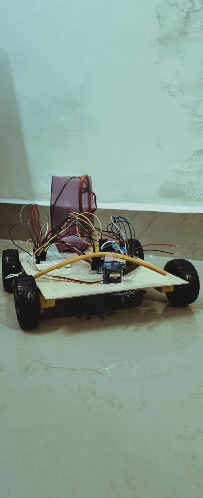
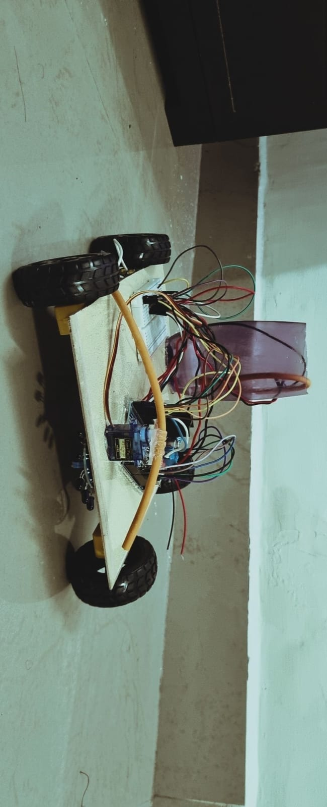

# Fire-Fighting Robot Car

**Solo college hardware project | 2023 | Third semester**

## Problem
Small fire-response demonstrations can show how sensing, obstacle avoidance, motion control, and an extinguishing mechanism work together. This project is an Arduino-based wheeled robot that detects a flame, avoids obstacles, confirms heat, and directs water at the target.

## Who it is for
A college-project reviewer or beginner embedded-systems learner interested in sensor integration, basic autonomous behaviour, and actuator control.

## Goal and success criteria
Build and program a robot car that:
- detects flame direction with a three-channel IR flame sensor;
- uses an ultrasonic sensor to avoid obstacles;
- uses a temperature sensor to confirm elevated heat/protect electronics;
- drives motors through an L298N motor driver;
- operates a water pump; and
- moves a servo-mounted nozzle toward a detected flame.

No quantified detection range, extinguishing time, or accuracy is currently claimed because those results were not recorded.

## Scope
**In:** Arduino C/C++ firmware, Arduino board, three-channel flame sensor, ultrasonic and temperature sensors, L298N motor driver, DC motors, servo, water pump/tank/pipe, wiring, prototype testing, and safety notes.

**Out:** certified fire-safety equipment, unattended real-world use, autonomous operation near people/property, and claims of emergency-response capability.

## Key decisions
- Use a wheeled Arduino platform to combine movement and sensing.
- Use the IR flame sensor to identify a possible flame direction.
- Use ultrasonic sensing for obstacle avoidance.
- Use temperature sensing as a heat check, not as a guarantee of fire detection.
- Use a servo-mounted water nozzle to aim at the detected target.

See [decisions](docs/03-decision-log.md).

## Outcome
A working solo college prototype was built in 2023. Two original build photographs are now included below. The original Arduino sketch, demonstration video, exact wiring/pin map, and measured test data are still to be uploaded to this repository.

## Build evidence

The following original photographs show the four-wheel chassis, visible breadboard/wiring, front-mounted servo/nozzle tubing, and onboard container/tubing arrangement. They establish that a physical prototype was built; they do **not** by themselves verify individual sensor behaviour, wiring correctness, pin assignments, or measured fire-extinguishing performance.

| View | Evidence |
| --- | --- |
| Front / low angle |  |
| Top / side angle |  |

See [build-evidence.md](docs/build-evidence.md) for captions and evidence limits.

## Risks and mitigations
Water, electricity, hot surfaces, moving motors, and false sensor readings all introduce safety risks. The project is for controlled demonstration only. See [risks and safety notes](docs/04-risks.md).

## How to run
1. Upload the original Arduino sketch once it is added to this repository.
2. Verify the pin map against the physical build before powering the robot.
3. Test motors, servo, sensors, and pump individually with the robot raised safely off the ground where appropriate.
4. Use only a small controlled demonstration setup; do not use mains power, real fires, or unattended operation.

## Next steps
- Add the original Arduino sketch.
- Upload photos and a short demo video that you own.
- Confirm exact pin assignments and component specifications.
- Complete the test log with measured results.
- Add a wiring diagram/behaviour diagram and bill of materials detail.

## Documentation
- [Brief](docs/01-brief.md)
- [Requirements](docs/02-requirements.md)
- [Decision log](docs/03-decision-log.md)
- [Risks and safety notes](docs/04-risks.md)
- [Quality and test log](docs/05-quality-and-tests.md)
- [Retrospective](docs/06-retrospective.md)
- [Bill of materials](docs/bill-of-materials.md)
- [Pin map](docs/pin-map.md)
- [Behaviour diagram](docs/behaviour-diagram.md)
- [Build evidence](docs/build-evidence.md)
